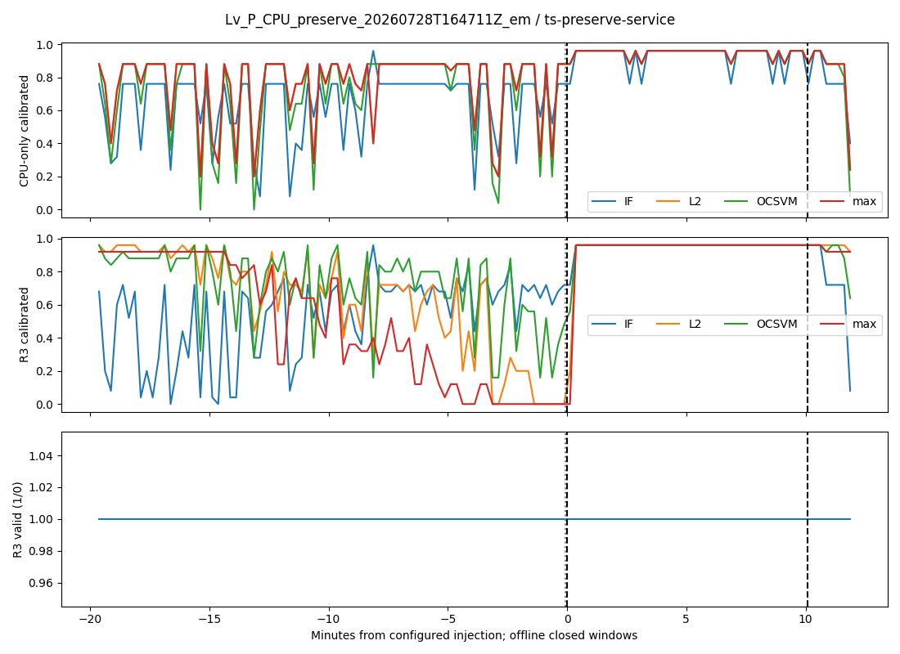
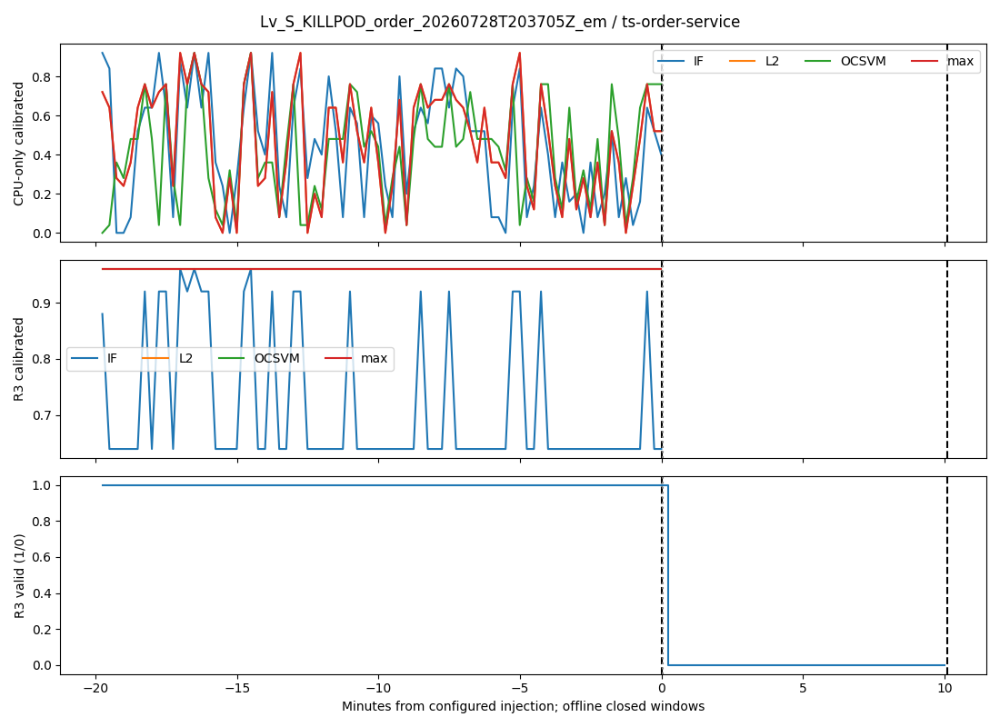
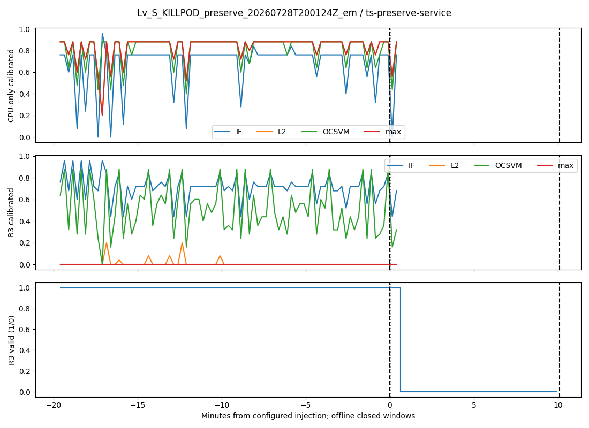

# Service 最小实验：2026-10-14 早期中期候选

S1运行状态与S2受控注入目标检索分开；S3完整根因定位不属于本轮。25候选、3事件、8臂均保留。

独立S1 n_known=0、AUROC=None、AP=None；人工读取同源输入不构成独立真值。

Normal_tail仅描述分位，不是独立误报率；Unknown不代表健康。KILL不可评分保留失败和分母。不支持在线提前量、窗口独立重复、跨故障泛化或两个新方法已完成。

[25 Service覆盖](service_coverage.csv) · [逐事件8臂排名/覆盖](event_comparison.csv) · [全部候选Unknown原因](coverage.csv) · [Normal尾段](normal_tail_summary.csv) · [证据等级](evidence_grades.csv) · [失败模式](failure_modes.csv)

| event_id                                  | feature_group   | method   | target_service      | target_status   |   target_score |   rank_best |   rank_worst |   unknown_count |   n_candidates |   hit_at_1 |   hit_at_3 |        rr |   target_coverage |
|:------------------------------------------|:----------------|:---------|:--------------------|:----------------|---------------:|------------:|-------------:|----------------:|---------------:|-----------:|-----------:|----------:|------------------:|
| Lv_P_CPU_preserve_20260728T164711Z_em     | CPU-only        | L2       | ts-preserve-service | Scored          |           0.96 |           1 |            3 |               0 |             25 |          0 |          1 | 0.333333  |                 1 |
| Lv_S_KILLPOD_order_20260728T203705Z_em    | CPU-only        | L2       | ts-order-service    | Unscorable      |         nan    |         nan |          nan |               0 |             25 |          0 |          0 | 0         |                 0 |
| Lv_S_KILLPOD_preserve_20260728T200124Z_em | CPU-only        | L2       | ts-preserve-service | Unscorable      |         nan    |         nan |          nan |               0 |             25 |          0 |          0 | 0         |                 0 |
| Lv_P_CPU_preserve_20260728T164711Z_em     | CPU-only        | max      | ts-preserve-service | Scored          |           0.96 |           1 |            3 |               0 |             25 |          0 |          1 | 0.333333  |                 1 |
| Lv_S_KILLPOD_order_20260728T203705Z_em    | CPU-only        | max      | ts-order-service    | Unscorable      |         nan    |         nan |          nan |               0 |             25 |          0 |          0 | 0         |                 0 |
| Lv_S_KILLPOD_preserve_20260728T200124Z_em | CPU-only        | max      | ts-preserve-service | Unscorable      |         nan    |         nan |          nan |               0 |             25 |          0 |          0 | 0         |                 0 |
| Lv_P_CPU_preserve_20260728T164711Z_em     | CPU-only        | OCSVM    | ts-preserve-service | Scored          |           0.96 |           1 |            2 |               0 |             25 |          0 |          1 | 0.5       |                 1 |
| Lv_S_KILLPOD_order_20260728T203705Z_em    | CPU-only        | OCSVM    | ts-order-service    | Unscorable      |         nan    |         nan |          nan |               0 |             25 |          0 |          0 | 0         |                 0 |
| Lv_S_KILLPOD_preserve_20260728T200124Z_em | CPU-only        | OCSVM    | ts-preserve-service | Unscorable      |         nan    |         nan |          nan |               0 |             25 |          0 |          0 | 0         |                 0 |
| Lv_P_CPU_preserve_20260728T164711Z_em     | CPU-only        | IF       | ts-preserve-service | Scored          |           0.96 |           1 |            8 |               0 |             25 |          0 |          0 | 0.125     |                 1 |
| Lv_S_KILLPOD_order_20260728T203705Z_em    | CPU-only        | IF       | ts-order-service    | Unscorable      |         nan    |         nan |          nan |               0 |             25 |          0 |          0 | 0         |                 0 |
| Lv_S_KILLPOD_preserve_20260728T200124Z_em | CPU-only        | IF       | ts-preserve-service | Unscorable      |         nan    |         nan |          nan |               0 |             25 |          0 |          0 | 0         |                 0 |
| Lv_P_CPU_preserve_20260728T164711Z_em     | R3              | L2       | ts-preserve-service | Scored          |           0.96 |           1 |           19 |               0 |             25 |          0 |          0 | 0.0526316 |                 1 |
| Lv_S_KILLPOD_order_20260728T203705Z_em    | R3              | L2       | ts-order-service    | Unscorable      |         nan    |         nan |          nan |               0 |             25 |          0 |          0 | 0         |                 0 |
| Lv_S_KILLPOD_preserve_20260728T200124Z_em | R3              | L2       | ts-preserve-service | Unscorable      |         nan    |         nan |          nan |               0 |             25 |          0 |          0 | 0         |                 0 |
| Lv_P_CPU_preserve_20260728T164711Z_em     | R3              | max      | ts-preserve-service | Scored          |           0.96 |           1 |           18 |               0 |             25 |          0 |          0 | 0.0555556 |                 1 |
| Lv_S_KILLPOD_order_20260728T203705Z_em    | R3              | max      | ts-order-service    | Unscorable      |         nan    |         nan |          nan |               0 |             25 |          0 |          0 | 0         |                 0 |
| Lv_S_KILLPOD_preserve_20260728T200124Z_em | R3              | max      | ts-preserve-service | Unscorable      |         nan    |         nan |          nan |               0 |             25 |          0 |          0 | 0         |                 0 |
| Lv_P_CPU_preserve_20260728T164711Z_em     | R3              | OCSVM    | ts-preserve-service | Scored          |           0.96 |           1 |           17 |               0 |             25 |          0 |          0 | 0.0588235 |                 1 |
| Lv_S_KILLPOD_order_20260728T203705Z_em    | R3              | OCSVM    | ts-order-service    | Unscorable      |         nan    |         nan |          nan |               0 |             25 |          0 |          0 | 0         |                 0 |
| Lv_S_KILLPOD_preserve_20260728T200124Z_em | R3              | OCSVM    | ts-preserve-service | Unscorable      |         nan    |         nan |          nan |               0 |             25 |          0 |          0 | 0         |                 0 |
| Lv_P_CPU_preserve_20260728T164711Z_em     | R3              | IF       | ts-preserve-service | Scored          |           0.96 |           1 |           12 |               0 |             25 |          0 |          0 | 0.0833333 |                 1 |
| Lv_S_KILLPOD_order_20260728T203705Z_em    | R3              | IF       | ts-order-service    | Unscorable      |         nan    |         nan |          nan |               0 |             25 |          0 |          0 | 0         |                 0 |
| Lv_S_KILLPOD_preserve_20260728T200124Z_em | R3              | IF       | ts-preserve-service | Unscorable      |         nan    |         nan |          nan |               0 |             25 |          0 |          0 | 0         |                 0 |

灰线为保存的首次效果证据区间起点，CPU并非精确生效瞬间；元数据关联仅作图表展示。

# Service 方法准入（T5，2026-10-14）

结论：**A 停止资源模型扩展；B 仅条件性候选；C 尚未验证。** 当前未发现开发复杂资源模型的必要性。先补评价/观测条件，不能把 R3 的较弱目标检索排名包装成新方法动机。本轮没有新模型、训练、重评分或原始文件解析。

依据为冻结根 `artifacts/service_minimal_v1_20261014T100628Z` 的 data/run/evaluation；新分析只写同根 admission。逐事件/服务/核心窗口、证据 ID、来源文件与后续条件见 `admission/failure_modes.csv`。可复现命令及输入/输出 SHA256 见 `admission/analysis_manifest.json`，分析脚本为 `admission/analyze.py`。

## 已知失败与尚未验证假设

CPU preserve 有35/35有效核心窗。CPU-only L2/max/OCSVM 在单事件受控暴露弱对照中 AUROC=0.988868、AP=0.963526；R3 L2/max/OCSVM 为1，IF为0.999629/0.999206。这里比较77个未暴露窗和35个暴露窗，15窗 Unknown；没有证明未暴露窗健康，也没有独立 S1 金标。CPU 单列已能解释该事件的时间暴露关联，额外维度没有建立新的独立状态辨识能力。

S2 是另一任务。24个 Normal 校准窗使经验尾部得分上限为24/25=.96；全部8臂目标事件分数均为.96。CPU-only L2/max/OCSVM/IF 同分候选数（含目标）分别3/3/2/8，R3分别19/18/17/12。目标 CPU-only 各臂有30/35窗达到上限，R3为35/35。固定top20%聚合因此饱和，并列按保守最差名次评价；R3较弱排名不能解释为在有效输入下没有识别 CPU 时段。也不能比较不同Service的raw分数打破当前协议并列。详细统计见 `calibration_ties.csv`。

两 KILL 目标各35个核心窗全部 IDENTITY_AMBIGUOUS，资源及分数覆盖0；全部臂 Unscorable，事件检索失败且保留宏平均分母。这是稳定单实例模型在旧新系列混淆下的观测适用边界，不能称有效输入下模型分类失败。旧新身份数不证明多个活副本；Killing不参与资源筛选，且只证明实例终止，不能作为完整服务可用性金标。

Normal 漂移仍是未验证假设。已知校准饱和不证明漂移，Normal_tail 分位数也不是独立误报率。当前只1次 Normal、3次事件、1次 CPU 干预、2个目标服务、0个独立 S1 窗口标签；同事件相关窗或201次 Killing 不增加独立实验数。

CPU first_effect_evidence_ms 对应跨越注入起点的counter差分区间起点：1785258438000..1785258453000。它不是精确生效瞬间，区间早端小于配置注入起点不表示生效先于注入。此时间分辨率/区间歧义保留，不改冻结证据，也不据此计算在线延迟。

## Spec §12 五项准入

规格原文：“必须在正确管线下发现真实失败模式、有实际所需观测、明确公平对照和独立或严限定的可验证能力，并有新的确认事件/预先冻结扩展集避免在同3case迭代后再当独立测试。”

以下按原文拆成五项；PASS只表示该项已有依据，不代表整体准入。

|准入条件|决定|依据与缺口|
|---|---|---|
|正确管线下存在真实失败模式|PASS|T4已审查的固定管线；S2饱和并列和KILL目标无覆盖可复现。失败位置已归类，不归因成网络能力不足。|
|有解决该失败实际所需观测|FAIL|KILL缺真实活实例/Ready及独立可用性信息；现有Metric无法恢复。B所需执行输入尚未在本协议形成可评分、匹配标签的验证集。|
|明确公平对照|PASS|冻结CPU-only/R3共享R3有效ID，L2/max/OCSVM/IF、Normal-only参考、固定25候选与3事件。Killing报警不充当资源模型公平对照。|
|独立或严限定的可验证新能力|FAIL|CPU弱对照可验证既有基线暴露关联；独立S1 n_known=0，尚未定义并验证新方法新增能力。不能用同输入标签升级证据。|
|新确认事件/预先冻结扩展集避免同3case迭代验证|FAIL|没有新的独立确认事件，也没有本轮已冻结并验证的扩展集；不能机制调参后把同3case再称独立测试。|

五项未全部通过，**方法开发不准入**。负向结果、工程实现、质量诊断、现成算法组合、R3较弱排名均不自动成为创新。

## 后续边界与预算

A：结束本轮资源基线及方法准入；保留未调整结果用于中期材料，S1独立AUROC/AP继续null，S2明确为注入目标检索，不是完整根因定位。

B：仅在另获授权、明确执行状态任务及独立或严格弱验证边界、冻结新增确认事件后，另写Spec/Plan做最小Entry/Log观测与固定错误指标对照。先检查固定错误指标是否足够，再讨论新方法。原始Entry缺席不能用Gateway或summary补齐；同来源标签不成为独立真值。此次不实现B。

C：当前只允许解释实例变化/采集混淆的质量诊断。缺正常重启、采集丢失和活实例对照，不能声称可靠性机制已验证或可学习区分。此次不实现C。

用户可用人工预算未知；没有把agent耗时换算成人工小时。2026-10-24前预算尚未确认，2026-10-26为后续计划日历节点，尚未发生、未完成；历史40–60h不是确认预算。若新增观测/验证无法在冻结前稳定，后置至中期后。本次T5完成不依赖新模型成立。

10月26日冻结是未来计划节点。Endpoint公平9维RED/12维Response实验按原协议引用，不与expanded18/21维混表；KILL传播是此前审计证据，本轮没有重读raw。
