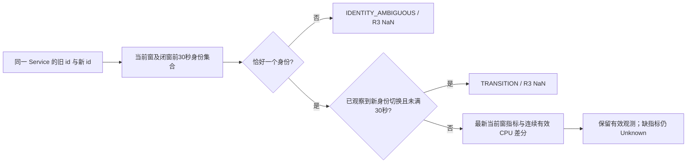

# Service-Minimal v1：任务定义与冻结证据（初稿，T0）

> 状态：T0 协议冻结（2026-10-14）。本文档与 `configs/service/minimal_v1.yaml`、
> `configs/service/evidence_minimal_v1.json`、`src/service/protocol.py` 同步；
> 9 条证据记录均为 `confirmed`；确认记录不改变证据等级，也不补足完整 Service 状态金标。

## 1. 任务定义

在现有 per-endpoint contract 之外，建立一条 **service 粒度、资源指标最小集** 的
单类异常检测支线，目的不是再刷一个 AUROC，而是回答一个更便宜、更可审计的问题：

- 只用 Normal 训练（one-class），在 service × 15s 窗粒度上检测资源层异常；
- 模型主输入冻结为 R3 = `[cpu_cores, memory_usage_ratio, process_count]`，
  另设 CPU-only 单变量臂；身份、阶段、注入事件、客户端字段一律不进模型；
- 候选实体、case、切分、方法、信息预算全部在数据处理前冻结
  （`configs/service/minimal_v1.yaml`），错误实体或非法输出路径在处理前失败。

### 1.1 为什么需要这条支线

现有 endpoint 融合链路的最强结论目前被平凡基线占据（rel_pos 0.9656，见 CLAUDE.md
研究状态），根因是采集模板的时间可预测性。service-minimal 支线主动收窄问题：

1. **标签语义更硬**：Killing 事件、CPU stress 是可独立核验的干预事实，
   不依赖故障注入时刻的机械对齐；
2. **信息预算更小、更可审查**：6 个资源列 + 状态列，不存在四模态拼接里
   "哪一模态泄漏了标签"的归因困境；
3. **与 P-B（per-endpoint baseline）协议互补**：它检验"资源层是否真的发生了
   可观测变化"（S1），而不是直接声称"服务不可用"（S2）。

### 1.2 冻结范围

| 项 | 冻结值 |
|---|---|
| case | Normal_20260728T161044Z；Lv_P_CPU_preserve_…164711Z_em；Lv_S_KILLPOD_order_…203705Z_em；Lv_S_KILLPOD_preserve_…200124Z_em |
| 候选服务 | 25 个 `ts-*-service`（字典序；数据库/基础设施排除），不随标签/分数/覆盖改变 |
| 窗口 | 15000ms，ceil 对齐，只保留完整窗；guard 30000ms |
| Normal 切分 | 时间窗 60/20/20（normal_fit 72 窗 / calibration 24 / tail 24），同窗 25 服务不拆散 |
| Fault case | 全部窗为 fault_evaluation，无任何训练窗 |
| 方法 | L2、max、OCSVM、IF；特征组 R3 与 CPU-only；seed 42 |
| 阈值参数 | min_fit_rows=30、min_calibration_rows=10、max_counter_gap_s=30、transition_ms=30000、event_min_coverage=.8、event_top_fraction=.2 |
| 禁止项 | Fault 专属适配、超参数搜索、score-dependent 选择 |

### 1.3 三个任务的边界定义（S1/S2/S3）

本支线包含三个语义强度不同的任务，v1 只开发 S1 与受限版 S2，S3 明确 NO-GO。
三者共用同一冻结协议（候选/case/信息预算），但允许声明的结论严格不同，
禁止把弱任务的结果叙述成强任务。

**S1 — 资源层单类异常检测（本版主任务，开发）**

- 输入：仅 R3（CPU-only 臂仅 `cpu_cores`）+ 实体键与观测有效性；
- 训练：只用 normal_fit/normal_calibration 段，故障 case 零训练窗；
- 允许结论：某 service × 15s 窗的资源形态偏离了正常分布；
  对 CPU case 可额外报告与受控暴露弱对照（proxy_label）的一致性；
- 禁止结论：把"资源偏离"直接叙述为"服务不可用"或"该服务是根因"。

**S2 — 事故级注入目标 Service 检索（受限开发，T4 固定事件检索）**

- 任务设定：对每个事故 case（CPU preserve、KILL order、KILL preserve 三个事件），
  在冻结的 25 个候选 Service 内做排序检索，排序依据是协议冻结的事件检索规则
  （event_min_coverage=.8、event_top_fraction=.2），不允许逐 case 调参或按分数挑规则；
- 指标：Hit@1、Hit@3、MRR，真值为该事故 CONTROLLED_EVENT 记录的实际干预对象
  （ts-preserve-service / ts-order-service / ts-preserve-service）；
- 允许结论：**在受控事件范围内**，系统能否把实际干预对象排在候选前列
  （事故级 injection-target retrieval）；
- 禁止结论：
  1. 不得叙述为"完整根因定位"——干预目标是实验者外部施加的对象，
     不等于自然事故中因果链上的责任服务；
  2. 不得叙述为"全部实际异常 Service 集合"——下游受波及服务、共享资源受害者
     （如 CPU contention 的邻居）不在该真值内，检索结果不提供集合覆盖语义；
  3. 证据不足（KILL 两 case 的服务可用性当前为 UNKNOWN）时报告 Unknown，
     不用排序结果反推状态金标。

**S3 — 完整根因 Service 定位（本版 NO-GO，不开发）**

- 显式声明：service_minimal_v1 不开发、不评估完整根因定位任务，
  论文/报告中不出现 "root cause localization" 口径的 S3 数字；
- NO-GO 理由：① 数据只有受控注入的干预标签，没有自然事故的因果链真值，
  干预对象 ≠ 根因；② 资源指标无法区分"施害者"与"受害者"
  （CPU stress 的目标与其资源受挤压的邻居在 R3 上可能同向异常）；
  ③ 缺独立于模型输入的服务依赖/状态证据，无法闭合因果判断；
- 硬约束：禁止以注入标签（target_service / inject 时段）替代根因真值来"造" S3 评估；
  若未来重启 S3，必须先补独立因果证据与评估协议，走新协议版本，不得在 v1 上扩展。

## 2. 三个主事件的选入理由与证据定级

证据全部落在 `configs/service/evidence_minimal_v1.json`（9 条），
source_locator 只记录稳定标识（事件时间/Pod/指标选择器/source 文件 sha256），
不引用会漂移的数组行号。

### 2.1 CPU stress（Lv_P_CPU_preserve，目标 ts-preserve-service）

- **CONTROLLED_EVENT**：StressChaos YAML 证明干预设计（app=ts-preserve-service，
  cpu.load=60/workers=1），计划区间来自 case_metadata；但现存 YAML 不是采集当时
  冻结的 spec/status，只证明"计划做了什么"。
- **OBSERVATION_DERIVED**：metric 输入证实资源确实变化——baseline CPU rate
  最大 0.0597 cores（n=80），注入后首个采样间隔（inject+10.4s，ts=1785258453s）
  0.2826（4.7×），随后样本 0.37~0.60（约 7.5~10×）。因为 metric 同时是模型输入，
  这条变化**不能**当独立状态金标（S1），只能作受控暴露弱对照（proxy_label）。
- **UNKNOWN（恢复时序）**：configured inject_end 后第一个采样间隔仍为 0.996 cores，
  约 35s 后才回落到 0.008；卸载滞后机制无独立证据，恢复边界保留 Unknown，
  不把 configured end 当实际恢复时刻。

### 2.2 KILL order（Lv_S_KILLPOD_order，目标 ts-order-service）

- **CONTROLLED_EVENT**：Schedule(PodChaos pod-kill, mode=one, @every 3s) 的计划。
- **INSTANCE_TERMINATION（INDEPENDENT_STATE）**：K8s Killing 事件 201 条、
  201 个不同 Pod，首条 1785272238000（计划起点 +2.3s）、末条 1785272838000。
  Killing 独立于模型输入，能证明"实例被终止"，但 Killing/Created/Started ≠ Ready。
- **SERVICE_UNAVAILABLE 不自动成立**：mode=one 每次只杀一个副本，其余副本可能继续
  服务；没有 readiness/endpoint 状态或独立于模型输入的服务端成功请求率，整窗
  服务可用性标 UNKNOWN（`unknown::…::service_availability`），等待 T4 固定检索。
- 该 case inject_end 比 window_end 大 90ms，网格截到 window_end，自然无 recover 窗。

### 2.3 KILL preserve（Lv_S_KILLPOD_preserve，目标 ts-preserve-service）

- 同 2.2 的三层定级；Killing 201 条/201 Pod，首条 1785270099000、末条 1785270700000。
- 审计划记中保留"目标运行观测歧义"（前序可行性审计提出，待 T4 核实），
  可用性 UNKNOWN 的 review_note 已显式记录该歧义。

### 2.4 定级规则（validate_evidence 的强制边界与人工纪律）

代码层强制（违反即校验失败，有测试锁定）：

- `depends_on_input_sources` 非空 ⇒ 禁止 INDEPENDENT_STATE
  （人工阅读同一 Log/Trace 只增强语义，模型也消费该来源时仍是 OBSERVATION_DERIVED）；
- INDEPENDENT_STATE ⇒ 必须 `heldout_from_model=true`（声称独立于模型输入来源，
  就不能同时对模型可见，二者矛盾即拒绝；review_status=confirmed 不是 schema 层要求，
  那是 T4 评审流程的事）；
- Killing/实例终止类 fact_type ⇒ 禁止自动派生 SERVICE_UNAVAILABLE + independent_label=1；
- 此外 schema 还机械强制：非空枚举列（unit/state_class/evidence_grade/review_status）
  不允许 NaN、case/service 必须在冻结集合内、start_ms ≤ end_ms、枚举值合法。

人工评审纪律（schema 无法机械判定，靠 pending_human_review 与后续评审把关）：

- 2.1–2.3 的 UNKNOWN 条目（CPU 恢复滞后、KILL 两 case 的服务可用性、KILL preserve
  目标运行观测歧义）是按"无独立证据不猜"的纪律保留的，不是 schema 强制；
- 未确认时段用计划区间回填实际状态、把 OBSERVATION_DERIVED 升级成 INDEPENDENT_STATE、
  review 状态随意升级，均属于评审阶段拦截范围。

## 3. S1（独立状态证据）为什么不足

当前三个事件里，唯一满足 INDEPENDENT_STATE 的事实只有 **实例终止**：

- CPU 变化的唯一观测通道是 metric——而 metric 正是模型主输入，循环论证；
- 服务不可用性没有独立观测：集群侧缺 readiness/endpoint Ready 历史导出，
  应用侧的 trace/log/client 错误需按实际配置的模型输入来源与状态语义判断独立性：
  本版资源模型仅输入 Metric，同一 Metric 派生标签仍属 OBSERVATION_DERIVED；
  留出的其他来源还需证明其对应的 Service 状态、单位及覆盖，不能直接把
  客户端 HTTP 错误等同于内部资源异常或整个 Service 不可用；
- 因此 v1 的评估叙述必须分层：
  - S1 可声明的：干预发生（CONTROLLED_EVENT）、实例终止（INDEPENDENT_STATE）；
  - 只能弱对照的：目标资源变化（proxy exposure，baseline 窗=0 / inject_core 窗=1）；
  - 暂不声明的：故障窗 = 服务不可用金标。
- 模型输出的解读相应限定为"资源层偏离正常"，下游若要主张检测到了服务故障，
  T4 的 S2 仅评价注入目标 Service 检索，不能据此声称服务不可用性检测；
  不允许在分数侧做阈值相关的事后选择。

## 4. PPT 第一页草案（一句话 + 三张证据卡）

**标题**：Service-Level One-Class Anomaly Detection with a Frozen, Auditable Information Budget

**一句话**：只用正常资源指标训练单类模型，在 25 个服务 × 15s 窗上检测资源层偏离；
评估标签按证据独立性分级，实例终止可独立核验，服务不可用性不做无证据假设。

- 卡 1（设计）：4 case / 25 service / 15s 窗全部冻结；模型只见
  cpu_cores、memory_usage_ratio、process_count（CPU-only 臂仅 1 列）；
  phase、target、Killing 事件在物理上不进入特征表（schema 校验拒绝）。
- 卡 2（证据）：CPU 注入后首个采样间隔 4.7×baseline 峰值（metric 派生，弱对照）；
  KILL 两 case 各 201 次独立 Killing 事件覆盖 201 个 Pod（实例终止金标）。
- 卡 3（诚实边界）：我们不声称故障窗等于服务不可用——mode=one 杀单副本，
  且没有独立于模型输入的可用性观测；未知时段显式标 UNKNOWN，
  检测结论以"资源偏离 + 独立事件"的合取呈现。

## 5. T0 交付物与后续边界

- 交付：`configs/service/minimal_v1.yaml`、`evidence_minimal_v1.json`、
  `src/service/protocol.py`（12 个公共签名）、`tests/test_service_protocol.py`（4 测试）。
- 明确不做（留给后续任务）：流读 metric CSV 与实体消解（T1）、prepare 入口/Hydra CLI（T2）、
  基线与检测器（T3）、S2 固定事件检索（T4）。
- 任何签名或 schema 与冻结 spec 不符时，停下来改 spec，不在实现里静默变通。

## 6. T1：资源观测实现与 PPT 容器/身份示意（2026-10-14）

`src/service/metrics.py` 新增只读流读和资源构建；旧 MetricPreprocessor 保持原状。
原始 CSV 用 PyArrow 投影必要列，逐批过滤配置中的 case、应用容器及五类指标，
保留完整系列键与一基数据行号（不计 CSV 表头）。只读预算为 case 范围及其开始前
30 秒，不读取日志、Trace、Endpoint 或 Kubernetes 生命周期事件。

| 原始观测 | T1 处理 | 示例含义 |
|---|---|---|
| 父 cgroup、空 container、POD、sidecar | 排除，不参与应用资源聚合 | 父级 usage 不再覆盖应用 usage |
| 注册应用 usage=100、limit=200 | ratio=.5 | 分母必须来自当前窗同身份；ratio>1 保留 |
| limit=0 | 保留 limit=0，ratio=NaN/NO_DENOMINATOR | 已观测分母无定义 |
| limit 缺席 | ratio=NaN/UNOBSERVED | 缺少分母观测，区别于已观测零 |
| 同系列 CPU 10→13，真实间隔15秒 | cpu=.2核 | 间隔25秒时10→15同样=.2；不固定除15 |
| 首点、reset、间隔>30秒、空id | NaN，保留各自状态 | 零增量可为0，但不证明 Ready/死亡 |
| 同系列同时间同值/异值 | 同值去重；异值 CONFLICTING_SAMPLE | 冲突逐来源保留原值、文件、行号；不按文件顺序取值 |

CPU 优先 `cpu=total`，仅在闭窗前该完整 exporter 系列尚无 total 时使用空 cpu
标签；未来 total 不改变过去结果。每指标每窗取最新点；窗内任何同系列冲突使
涉及指标整窗缺测，且 `identity_ambiguity=True` 排除整窗资源评分。诊断字段冲突时
可保留合法 R3 值，但 `resource_valid=False`，覆盖损失显式报告。

旧新身份的 process=1 不会相加为2。无当前记录则 UNOBSERVED，不插值、不沿用旧
Gauge、不借 Killing 删除实例。全部25个候选的完整网格始终保留，两个无恢复范围的
KILL case 不生成额外恢复窗。`features.attrs.partial_windows` 记录首尾部分窗毫秒数，
`timestamp_semantics` 声明 Prometheus query_range 时间无法确认 scrape 新鲜度；后续
prepare 应将这些说明写入持久化质量报告，receipt 字段本版始终 null。

T1 fixture 验证涉及真实 dt、系列身份、容器隔离、重复/冲突、切换、CPU 因果标签
选择、无记录完整网格、分母/进程零值、原始来源、过滤与时间舍入边界。此处仅交付
预处理；检测器训练和正式事件评价由后续任务实现。

### 6.1 T1 原始检查与 T0 身份修复

本轮在 T0 原始身份配置下读取 Normal/CPU 两个指定 Metric CSV：分别得到3000/3175
完整网格行，2880/3048个有效 R3 窗。剩余候选 `ts-security-service` 的原始 Pod 实为
`ts-security-service-64996ff68-gwdfs`，修复前 T0 registry 实际写成
`ts-security-service-64996ff28d8-gwdfs`，且 Deployment 正则限定10位 hash，使实际9位
Pod 未被识别。这是 T0 身份配置/解析缺陷；现已修正 registry，并允许严格9或10位
ReplicaSet hash，同时仍要求完整服务白名单及5位 Pod 后缀。修复后限定 Normal/CPU
覆盖复核记录在 `artifacts/service_minimal_v1_20261014T100628Z/provenance/t0-guard-report.md`。

post-build 用元数据做诊断（不参与特征计算）：CPU preserve 的 baseline 中位数为
cpu=.0084028、ratio=.21540039、process=1；inject_core 为 .53116107、.22043164、4。
此前可行性审计的 inject 为 .53378597、.22042188、4。小差异来自完整窗范围、边界
保护和每窗最新观测等聚合语义；没有改规则逼近旧数。两者是输入侧观测对照，不能
充当独立状态金标或新检测器性能。

### 6.2 T1 评审修复：身份回归与数值范围

old→new→old 的旧身份再次出现也会自本次可证切换重新保护30秒，不能使用身份在
整个历史中的首次出现时间替代本次观测段起点。按query时间因果维护每身份的
last_seen与本次观测段起点，同时间样本整体处理。首次不同身份观察启动保护；
已知身份离开最近30秒观测预算、上次观测之后严格出现其他身份后再次观察，才作为新的回归段。
同时间的其他身份不构成缺口期间的切换证据；同身份缺记录回归时，CPU仍须单独检查gap。
交错的旧快照持续出现不后移新身份的首次起点；近期多身份仍优先标
IDENTITY_AMBIGUOUS。长时间没有记录、随后同身份再次出现，不凭空认定身份切换。
冷却结束后仍须满足同系列有效CPU差分，不沿用跨身份累计量。

CPU累计值即使有限，除以很小真实dt仍可能产生非有限rate；现统一转为NaN/
UNSUPPORTED，保留原值、dt与delta诊断，避免一个非法值使完整网格构建失败。
本次新增回归测试并完成T0/T1共57项检查；6.1所述T0身份缺陷已由单独提交ee83c5d
修复，此处原始覆盖数字为修复之前的开发检查，修复后的原始覆盖由controller复核。

T1复审round2补充old@0/15/45与new@30/60/75/90交错测试：new保护起点保持30，
旧快照45仍由30秒身份歧义规则保护，75窗恢复有效观测。回归身份保护与CPU溢出测试
同时保留，最终T0/T1共58项通过。身份段只代表原始观测连续性，不宣称真实实例生命周期。

## 7. T2：独立 prepare 数据与覆盖（2026-10-14）

`scripts/service_experiment.py` 实现 Hydra `command=prepare`，其余命令明确待实现。
prepare 逐项验证四 case 的真实元数据及唯一原始 Metric 文件，消费 T1 公共函数；
完整网格上冻结 `features / instance_quality / index / events / evidence`。
主索引的配对资格来自 R3 `resource_valid`，证据仅按同 case、同 Service、半开区间
相交关联。CPU 受控暴露弱标签单独保留；Killing 不用于筛选资源实例或修补 Unknown。

|资产|本轮状态|范围与 Unknown|
|---|---|---|
|原始 Metric、真实 case metadata、冻结证据|已有输入，仅只读|4 case、25 候选；不改正式 Endpoint 标签|
|Service 资源完整网格与共享时间索引|T2 新增|12,150 行；12,072 R3 有效，78 Unknown|
|Normal 参考分段|T2 新增索引，尚未训练|25 服务各 120 窗：fit 72 / calibration 24 / tail 24；全部 R3 有效|
|CPU preserve|T2 新增资源观测|127/127 有效；baseline 77、inject_core 35、boundary 10、recover 5|
|KILL order / preserve|T2 新增身份与质量诊断|目标分别 80/120、81/119 有效；各 inject_core 0/35，有效覆盖 0；候选仍保留|
|Service 独立可用性金标|仍缺失|Killing 只证明实例终止，CPU 变化依赖输入；不生成独立 AUROC/AP|
|检测器、评分与事件检索性能|待 T3/T4|本轮 prepare 没有拟合或训练|

两 KILL 目标的资源观测分别出现 47 / 45 个 container id；注入核心窗口全部因
近期多身份观测保留 `IDENTITY_AMBIGUOUS`。这些 id 数量不表示同时存活实例数；
Killing 的 201 条记录仍属于一个干预事件内重复动作。两个 KILL 的其余 24 服务
网格均有有效资源观测，不据此额外认定服务健康。

Normal/CPU 中 preserve、order 以及非目标 auth、gateway 均为稳定单系列。
CPU case preserve 的注入核心 CPU 最大值为 .984408 cores，auth / gateway 分别为
.030298 / .108675；这些是输入描述，没有拟合模型，也没有宣称检测能力。
所有查询时间保留 query_range 语义，真实 scrape 新鲜度和接收时间仍未知；
被裁掉的首尾部分窗口时长与原因存入 `quality_report.json`。

主数据目录为 `artifacts/service_minimal_v1_20261014T095447Z/data`。
首轮 `...20261014T095105Z/data` 保留开发审计并加 `superseded.md`：后来 fixture
揭示证据 nullable Int8 与有效 R3 行排除字段两项 Schema 问题，已修正后生成新目录。
不覆盖原产物，后续 score 使用主数据目录。大原始文件仅保存 path/size/mtime_ns，
明确是 stat 标识而非完整内容锁定；小配置/元数据与实际执行代码保存 SHA256。

### 7.1 T2 复审：冻结内容摘要

后续 score 主输入更新为 `artifacts/service_minimal_v1_20261014T100628Z/data`，
两个旧目录仅追加 superseded 说明。新 manifest 对 prepare 完成前的直接产物文件
保存完整 SHA256/大小，覆盖五份 parquet、resolved_config、schema、quality_report、
source_manifest、coverage 与 .gitignore；排除 manifest 自引用和完成/失败标记。
后续消费必须按此清单验证内容，不能只看行数、文件大小或 `_SUCCESS`。

三份 Chaos YAML 与两份 Kubernetes JSON 都小于固定 8 MiB 预算，现保存本轮完整
SHA256；小配置/元数据在资源扫描前后比较内容摘要，能检出保留大小与mtime的变动。
大 Metric/Log 仍仅stat标识，不为计算来源hash再次扫描原始大文件。
本次增加输出摘要范围/可重复性/同大小篡改检测和同stat来源变动检查，T0/T1/T2
共 **68项通过**，资源观测与Unknown规则未修改。

## 8. T4 实际评估（2026-10-14）

冻结的 `20261014T100628Z/data` 与 `/run` 已评估至同根 `/evaluation`。
全部 3 个事件 × 25 候选 × 8 臂保留为 600 行，每事件固定 35 个完整核心窗。
独立 S1 资源状态标签为 0，AUROC/AP 为 null；Killing 的实例终止证据没有升为服务资源金标。
CPU 暴露弱对照单独保存：77 个 baseline 对照窗、35 个 inject_core 暴露窗，15 个 Unknown；
这不是独立状态检测成绩。Normal_tail 只输出分位数，不称总体误报率。

|臂|CPU 排名区间|全3事件 Hit@3|全3事件 MRR|
|---|---|---|---|
|CPU-only L2|[1,3]|1/3|0.111111|
|CPU-only max|[1,3]|1/3|0.111111|
|CPU-only OCSVM|[1,2]|1/3|0.166667|
|CPU-only IF|[1,8]|0|0.041667|
|R3 L2|[1,19]|0|0.017544|
|R3 max|[1,18]|0|0.018519|
|R3 OCSVM|[1,17]|0|0.019608|
|R3 IF|[1,12]|0|0.027778|

两 KILL 目标资源覆盖均为 0，全部臂目标 Unscorable，Hit/RR=0，仍占宏平均分母。
全臂 Hit@1=0。CPU 校准饱和并列没有用 raw 分数打破；资源 Unknown 不能解释为健康。
这些结果展示固定基线及观测规则的适用边界，尚不能据此宣称新方法必要或完整 RCA 成立。
报告图表由 T6 的保存产物只读入口整合；没有已有PPT，因此交付中期逐页提纲。

## 9. T5 方法准入（2026-10-14）

本轮已完成基于冻结 data/run/evaluation 的失败模式分析，结论为 **A停止资源模型扩展、B条件性、C尚未验证**。完整五项PASS/FAIL、证据与预算边界见 [service-method-admission.md](service-method-admission.md)。新输出独立放在冻结根的 `admission/`，原有数据、模型和评价未覆盖。

CPU弱对照时间辨识较强（CPU-only L2/max/OCSVM AUROC=.988868；R3为1），而跨Service S2校准饱和造成保守并列：CPU-only同分候选2–8个，R3为12–19个。这两类任务的结果不矛盾；R3较弱S2排名不能证明新模型必要。两KILL目标0/35有效，属于身份歧义下无有效观测；独立S1标签仍0。Normal漂移未验证，不能以饱和直接证明。

本轮没有新模型/拟合/重评分或原始数据解析，仅消费现有表生成可复现CSV及SHA256清单。人工预算未知，未来日历节点不是完成记录；B/C实施和新方法验证都需要新的Spec/Plan与确认事件条件。

## 10. T6 报告与早期候选

`command=report`验证data/run/evaluation保存SHA，生成独立report目录，不拟合、重评分或解析raw。覆盖表保留25候选，事件表保留3事件×8臂；图使用已保存的闭窗分数与质量掩码。

[报告](../../artifacts/service_minimal_v1_20261014T100628Z/report_v3/report.md)与[逐页中期提纲](service-midterm-outline.md)。2026-10-14仅早期候选，10月26日冻结尚未发生。方法准入FAIL保持；本轮不宣称完成两个新方法。
